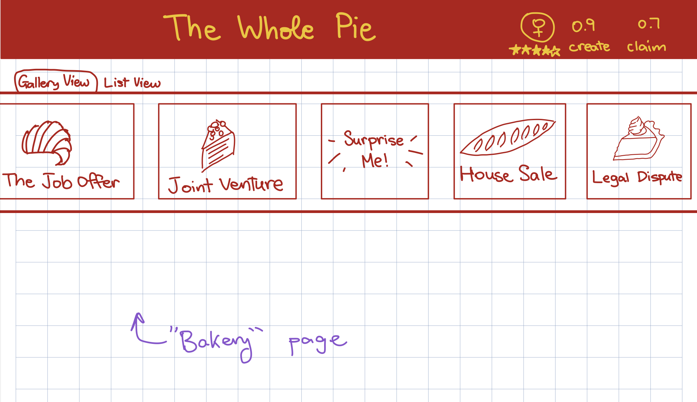
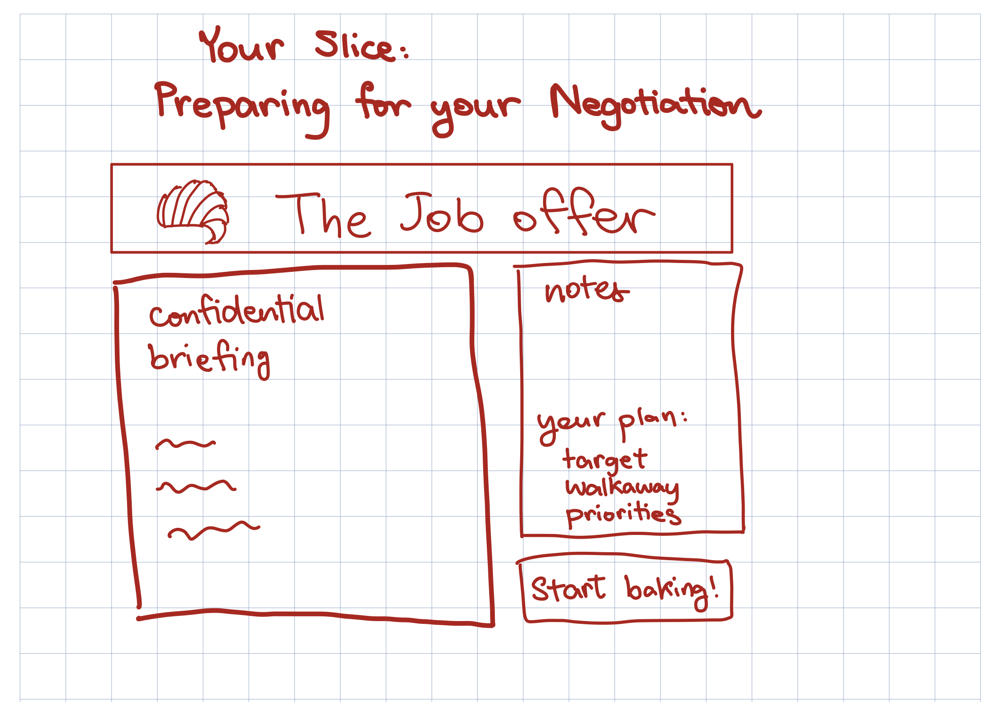
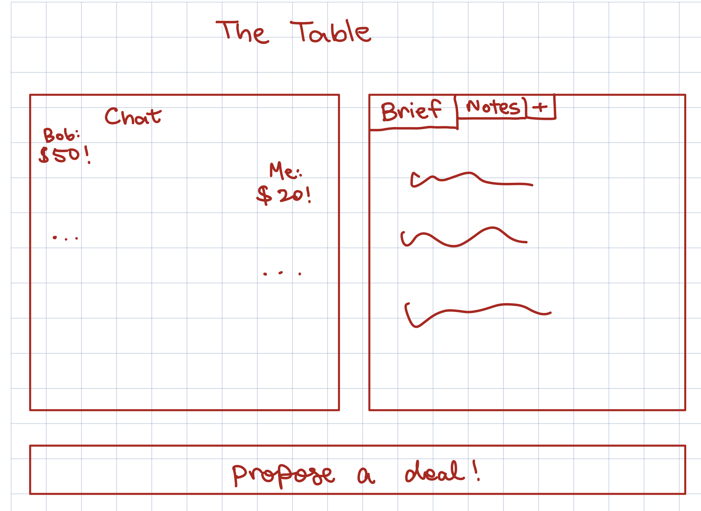
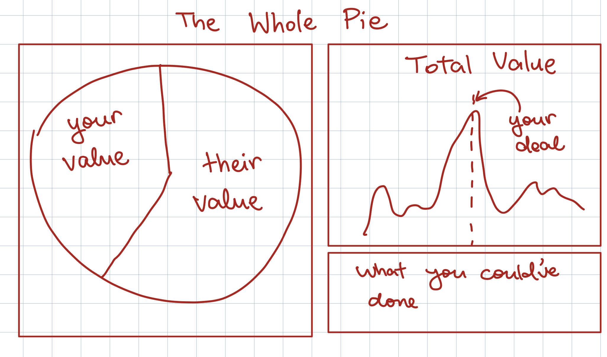

# Negotiations website

## Problem Statement

### **Domain**

Negotiation is the ability to collectively decide on a course of action with other parties, even when all parties have different objectives and opinions. Thus, a good negotiator helps choose a course of action that benefits themselves and the group.

Negotiation is an _essential_ skill for anyone who communicates often with other humans, whether it be at work or at home. I’m sure this claim seems outrageously broad to some readers: one might argue that haggling prices is a useful ability, but it’s hardly essential. However, “negotiation” doesn’t just refer to bargaining or haggling. Haggling is about how to _claim_ value in a discussion with another party, but a good negotiator is also able to create value.

For instance, a good haggler might be able to sell a huge contract, but a good negotiator might additionally be able to come up with an additional clause beneficial to both sides. Or a good haggler might be able talk their friends into going to their preferred restaurant, but a good negotiator might discover an activity that they all enjoy.

For a more concrete example: recently, I was exploring the joint venture between Dow Chemical Company and the Kuwait Petroleum Corporation--or rather, I was exploring the joint venture that never was--and I found another negotiation that failed. KPC and Dow announced plans to launch a joint venture that would have been one of the largest manufacturers of chemicals and plastics in the world, if it had managed to go through. I learned that Dow's CEO had gone onto a popular televised interview and repeatedly implied that Dow had won in the deal (and that therefore, the Kuwaiti side had lost). Rather than caring about creating value and maintaining the relationship with KPC, Dow's CEO was focused only on how well they'd managed to claim value. The Kuwaitis played a video of the interview during a meeting of the Kuwait's National Assembly, who are partially in charge of the KPC. While these interviews are not necessarily the only reason the deal fell through, they certainly had a very negative effect. As a result of the deal falling through, Dow lost out on $9.5 billion cash and estimated annual sales of $11 billion during the 2008 Recession, and another deal that depended on the KDow JV also fell through.

"But I'm not the CEO of a company," you might be thinking. "Does negotiation really matter for me?" Here's a more personal example. Suppose you and your friend really want to room together, but you have different price ranges and different location preferences. You prefer living somewhere cheaper further from the city, while your friend prefers to live somewhere closer to the city that's much more expensive. A haggler might end up "splitting the difference": the two of you live somewhere somewhat expensive that's somewhat close to the city, and neither of you are particularly happy. But a negotiator able to create value might realize that you care about price while your friend cares about location, so to satisfy both of you, you can live in your friend's preferred location and pay slightly less of the rent.

Clearly, being a poor negotiator in all of the above examples is quite detrimental. In fact, I would argue that the world would be a better place if the majority of people were skilled negotiators.

### **Corroboration, and Workarounds**

The only problem is that it’s rather hard to become a good negotiator. You can, of course, take classes or read books: that’ll help you learn, theoretically, how to be a good negotiator. But how do you practice your negotiation skills? Everyone has heard that it takes 10,000 hours to become an expert, so how can someone practice 10,000 hours of negotiation?

Classes are a good step, as they often involve some practical negotiation exercises and roleplay scenarios. But classes are difficult to access, good negotiation coaches might cost hundreds of dollars per hour, and it can also be difficult to apply knowledge from the classroom in real life.

[Other sources](https://www.pon.harvard.edu/daily/negotiation-skills-daily/5-tips-for-improving-your-negotiation-skills/) suggest practicing negotiation in low-stakes daily scenarios with friends. However, often, I don’t have an opinion on daily conversations like which dining hall to eat at, so I forget to practice negotiation. Even if I do remember to practice negotiating when talking to my friends, I get no diversity in negotiation partner, which also severely limits my improvement. Meanwhile, if I do enter a situation in which I have a strong opinion, I certainly don’t want to be merely practicing negotiation: I want to already be a good negotiator, able to make the best of the situation.

There are also plenty of solo drills that one can do to improve at negotiation—for instance, one might visualize high-stakes negotiations in their mind—but without another person to negotiate against, improvement is limited. If you only ever do solo drills, you won't know if your imagined partner is actually true to life.

The best way to actually learn negotiation is through practice, using existing roleplay exercises. However, most roleplay exercises are paywalled and require a negotiation partner, who might be difficult to find. After all, perhaps you can persuade your friends to do so with you, but their skill level may be vastly different from yours and they may not be available regularly. Not to mention, the most educational part of negotiation roleplays is debriefing afterwards and determining what value was missed, which can be difficult without a third-party observer (usually, the instructor of a class would take on this role).

Compare this difficulty in practicing negotiation to other disciplines. With something like math or computer science, it’s easy to find ways to practice, since there are so many problems available online and you can simply practice alone. Meanwhile, if you wish to improve at chess, for instance, you can simply create an account on chess.com and gain access to a huge community of chessplayers.

### **Bad Situation**

Thus, the bad situation in this domain can be broken down into the following points:

1. People often disregard the importance of creating value in favor of claiming value. They focus on haggling instead of on negotiating. People lose out on potential value by assuming that the pie is fixed, and that the other party's interests must be directly opposed to yours. And, crucially, they never learn better, because in real life, you only ever see your side of the negotation and never know what the whole picture looks like.
2. Even once someone understands the importance of all aspects of negotiation, from claiming value to creating value, it's difficult to apply the theory in real life.

Compounding the bad situation, many people try to avoid negotiating at all, out of fear and lack of confidence. For instance, more than half of job seekers accept their initial offer without attempting to counter, even though candidates who do counter see an average compensation increase of 12.45% ([Glassdoor](https://www.glassdoor.com/blog/new-job-offer-negotiate-current-salary/)).

### **Solution Sketch**

My proposed solution: create an online negotiation platform and community, serving a similar role for negotiation as chess.com does for chess.

To solve the first part of the bad situation, this platform needs to make it clear that when people haggle instead of negotiate, they're actually losing. The platform needs to make that loss visible through a post-negotiation debrief (through a scoring system and possibly an LLM explainer) of all the value that they failed to create.

To solve the second part of the bad situation, the platform needs to provide opportunity for people to practice negotiation.

Since practicing on the platform has no stakes on your real life, it also provides an opportunity for those people who are too scared to negotiate to practice and grow in confidence.

My solution consists of a few different stages.

The first stage (the MVP) consists of a one-player negotiation platform, where users can negotiate with an agent with a random personality (rash and easy to anger; quiet and shy; obstinate; collaborative; etc.). There will be a bank of two or three negotiation exercise skeletons, and there will be an agent that can build up new scenarios out of those skeletons. Each of those negotiation skeletons would have an accompanying scoring sheet that analyzes how well the negotiators did, in value claiming and value creating.

The second stage (the beta) adds multi-user interactions: being able to pair people up, adding rooms so that users can negotiate specifically with their friends, and hosting the site online (rather than locally) so that users can interact with one another.

Last year, I took a negotiation class at MIT. Our professor constantly told us that, by taking this one class, we were better at negotiating than the majority of people. While that’s gratifying, it’s also extremely depressing to know that taking a single 12-unit class can make me better than most people. I hope that this solution will be a step towards giving more people access to this important skill.

### **Stakeholders**

The Learner who needs practice: someone who took a class and understands the theory of negotiation, but hasn't had the opportunity to apply it; their knowledge is decaying, unused, and untested. This is me, and this is why I want to make this app.

Scenario Authors: While I can make up some scenarios, for really high-quality, interesting scenarios, I'll need to look up scenarios online. Necessarily, any website that tries to spread access to scenarios is going to heavily impact the authors of those scenarios: although it should be fine for a school project, if this website were to become larger and wider-spread, I would certainly need to contact them to purchase rights to use their scenarios.

The Haggler: someone who believes they're very good at negotiating, when really they're just really good at claiming value. By using this platform and seeing all the added value that they're losing out on, they will at least see their shortcomings (though it will still be up to them to choose to become better).

## Application pitch

**Name: The Whole Pie**

**Motivation:** Negotiation, the ability to not only claim value but also to create value in collaboration with others, is a skill that can only improve the human experience as a whole. However, to become better at a skill, you need to be able to practice that skill and learn from mistakes and feedback. **In real negotiations, you only ever see your side and not the whole picture, so it's impossible to truly determine if you were a successful negotiator.** For instance, a haggler might walk away from a negotiation believing that he "won" $5k when he actually missed out on $40k of joint value. **Whole Pie** provides users with a place to negotiate real cases with AI agents or real counterparts and shows them the whole pie after.

**Key Features:**

1. **The Case Bank:** **Whole Pie** has a bank of cases, or scenarios, for users to negotiate in. The bank is a set of generic skeleton cases, and an agent fills in the blanks to create unique cases for each negotiation. The agent will also generate confidentials that describes each user's perspective regarding the case. Each perspective will have preferences regarding aspects of the case, represented with different point valuations for each aspect.

2. **The Negotiation Table:** when a user wishes to practice negotiating, they will start a negotiation. Then, the system will either find another user or provide an agent for the user to negotiate with. The negotiators will receive the case confidentials and, after a set amount of time for preparation, will begin to negotiate under a clock. The negotiation will be via text chat on the platform (at least, for the MVP; later on, I might add voice and video chat options). Before the clock runs out, negotiators should commit to a term sheet, with one explicit option per issue.

3. **The Debrief:** after the session ends, the term sheet is graded based on both sides' point valuations for each aspect agreed upon. Three separate scores will be calculated: a user's claim score (their share of the joint surplus over the BATNAs), a user's create score (joint value achieved / maximum joint value), and relationship (the user's counterpart's post-session review of them). User scores will be compared against every other deal struck on this case, providing users with feedback on how well they did.

## Concept design

### Concepts

#### **concept** Case Bank [Author]

**purpose** A bank of all the negotiation case skeletons and negotiation cases instantiated from those skeletons.

**principle** an author writes a skeleton: the issues under discussion, the options available on each issue, and the knowledge that each person has about the situation. You can instantiate a skeleton by filling in the details (numbers, etc), producing a case that multiple parties can negotiate.

**state**

```
  a set of Skeletons with
    an author Author
    a title String
    a set of Strings Issues
    a set of RoleSpecs with
      a label String
      a briefTemplate String
  a set of Cases with
    a skeleton Skeleton
    an id String
    a set of Issues with
      a name String
      an optionRange (set of Strings)
    a set of Roles with
      a label String
      a PayoffSheet set of issueWeightings with
        an Issue
        an issueWeight Number
        a set of optionWeights with
          an option String
          an optionWeight Number
      a confidentialBrief String
```

**actions**

```
  defineSkeleton (author: Author, title: String, ...) : (skeleton: Skeleton)
    where that author has not created a skeleton with that title.
    then create a skeleton with that author and title.
  instantiate (skeleton: Skeleton, issueWeightings: a set of issueWeightings) : (case: Case)
    effect creates a Case whose issues, options, and per-role briefs are the
      skeleton's templates resolved with those issue weights, with a uniquely generated id.
  _getBrief (case: Case, role: Role) : (confidential: String)
    where role in case.Roles and case exists,
    then return the confidentialBrief for that role.
```

---

#### **concept** TripleRating [User]

**purpose** track a user's skill at claiming and creating value, as well as their relationship rating, since all three are essential to being a skilled negotiator.

**principle** a user has a claim rating, a create rating, and a relationship rating. These ratings are averages derived from all that user's negotiations.

**state**

```
  a set of Ratings with
    a user User
    a claim Number
    a create Number
    a relationship Number
    a totalNegotiations Number
```

**actions**

```
  record (user: User, claimShare: Number, createShare: Number, relationshipRating: Number)
    then
      if no Rating with this user exists, then create a Rating with this user, and set the claim, create, and relationship values to the inputs. Finally, set totalNegotiations to 1.
      if a Rating with this user exists, then update the claim, create, and relationship values to the new average, and increase totalNegotiations by 1.
```

---

#### **concept** NegotiationTable [User, Case Bank]

**purpose** give parties a space to negotiate in.

**principle** the negotiation table is opened for a case, with one seat per role; seated users exchange messages, which are recorded in order. After the negotiation ends, no further messages can be sent, and the transcript cannot be changed.

**state**

```
  a set of Tables with
    an id String
    a case Case
    a set of Seats with
      a user User
      a role Role
    a transcript seq of Messages with
      a sender (User)
      a body String
      a time DateTime
    a status of OPEN or SETTLED or WITHDRAWN or EXPIRED
    a termSheet set of Results with
      an issue Issue
      an option Option
    a debrief
      a description String
    a deadline DateTime
```

**actions**

```
  open (case: Case, deadline: DateTime): (table: Table)
    then create an OPEN Table with no seats and an empty transcript.
  seat (table: Table, user: User, role: Role)
    when table is OPEN and this role has not been seated yet
    then adds a seat with this user and this role.
  send (table: Table, sender: User, body: String): (message: Message)
    where table is OPEN and sender is seated at this table
    then append this Message to the transcript.
  settle (table: Table, outcome: set of Results)
    where table is OPEN
    then set this table's status to SETTLED and set the outcome to the input.
  withdraw (table: Table, user: User)
    where table is OPEN and the user is seated
    then set this table's status to WITHDRAWN
  expire (table: Table)
    where table is OPEN
    then set this table's status to EXPIRED
  debrief (table: Table) : (debrief String)
    where table is not OPEN
    then generate a string describing what was done well and what wasn't.
```

---

#### **concept** CounterpartAgent [NegotiationTable, CaseBank]

**purpose** provide an always-available practice partner that negotiates from its own private interests (given by the case) with a consistent personality.

**principle** a counterpart agent is created with a persona and a confidential brief that it can see but the user cannot. Each time the user speaks, it replies in persona, based on its own private information. It agrees to a term sheet only if that term sheet is above its BATNA.

**state**

```
  a set of Counterparts with
    a negotiationTable Table
    a brief String
    a persona String
    a BATNA String
```

**actions**

```
  assign (table: Table, brief: String, persona: String) : (c: Counterpart)
    then creates a Counterpart with this persona, and this brief, at this table.
  respond (c: Counterpart, heard: String) : (reply: String)
    then returns an in-persona reply consistent with c.brief and c.BATNA
  consider (c: Counterpart, terms: set of Term) : (verdict of SIGN or REJECT, reply: String)
    then SIGN if and only if the terms are above this persona's BATNA, and otherwise, reject.
```

---

### Reactions

Below is a reaction for starting a practice and then, once you choose the negotiation, choosing who to negotiate with (an agent with X personality or a human). I've only given the reaction for negotiating with an agent because the MVP isn't going to have human-human interaction; however, it would be easy to add human-human interaction, since you'd just need to set up an assignHuman reaction.

```
reaction startPractice
  when Requesting.startPractice (user: User, skeleton: Skeleton)
  then CaseBank.instantiate (skeleton, issueWeightings: randomized)  : (case)
      NegotiationTable.open (case, deadline: now + 40 min)          : (table)
      NegotiationTable.seat (table, user, role: case.Roles.first)

reaction assignAgent
  when
    Requesting.negotiateWithAgent (persona: String)
    CaseBank.instantiate() : (case)
  then Counterpart.assign(table, brief: CaseBank._getBrief(case, second), persona)
```

Below is a reaction for the negotiation agent responding when a user says something in a negotiation.

```
reaction counterpartResponse
  when NegotiationTable.send (table, sender, body) : (message)
  where a Counterpart c is seated at this table and sender is not c
  then Counterpart.respond (c, heard: body) : (reply)
    NegotiationTable.send (table, sender: c, body: reply)
```

And finally, this is (perhaps) one of the most important reactions: when the negotiation ends, you generate a debrief!

```
reaction revealPie
when  NegotiationTable.settle (table)
      or NegotiationTable.withdraw (table)
      or NegotiationTable.expire (table)
then  NegotiationTable.debrief (table) : (debrief)
```

### Concept explanation

The concepts above capture the core functionality of _The Whole Pie_: Namely, the concepts above allow a user to start a solo game and play against an agent. As the MVP is hosted locally, it's necessary that the MVP is playable with just one person.

The Case Bank is a concept describing the negotiation cases which users can practice with in _The Whole Pie_. For the MVP, I might honestly make it simpler and skip the "skeleton" aspect (and just have two or three example cases to work with).

The NegotiationTable represents each negotiation that the user actually participates in, from the start of the negotiation to the end (when the terms are agreed upon and the debrief has occured).

As mentioned above, the user must be able to play single-player games against an agent. Thus, we need to create an agent for the user to play with, which is the CounterpartAgent concept.

Finally, we also have the TripleRating concept. This concept is one that persists outside negotiations: it represents a user's overall skill level.

## UI Sketches






## User Journey

Nadia is a negotiation student who needs practice. She took a negotiations class a year ago; while the class was going on, she felt as if she was constantly learning more and improving, but now that the class has been over for a year, her negotiation skills have been decaying. A company had just offered her a job and it was only as she was complaining to her friend about the subpar benefits that she realized she'd completely forgotten to negotiate the offer.

Now, she wants to get back into practice with her rusty skills, but she's in a new city and doesn't know anyone to practice with. That's why she makes an account on **Whole Pie**.

Once she signs up, she lands in the _Bakery_. She starts a random new game ("Surprise me!") and, wanting to get started immediately, chooses to negotiate with an agent. She enters the _Your Slice: Prepping for the Negotiation_ page, where she's given ten minutes to read her confidential (fittingly enough, it's a job offer negotiation) and decide on a plan. The default setting for a new account is additional assistance, so the website gives Nadia suggestions on how to prepare, and doesn't allow her to continue to the next stage until she writes down her target, walkaway price, and priorities.

Then, she moves onto _The Table_, where she and her fellow negotiator (in this case, an agent) are given thirty minutes to negotiate. 25 minutes in, she realizes they've made no progress so, panicking, she offers to meet in the middle; but her negotiation partner sounds reluctant, too, so Nadia feels pretty good about her negotiation. It feels like she won.

But when _The Whole Pie_ is revealed, she discovers that she'd missed the opportunity to trade start date, which she didn't prioritize at all, for remote days, which her employer did not care about. Through the debrief process, she learns what she did well and did poorly throughout the negotiation process, allowing her to do even better in both her next practice negotiation, and her next real one.
